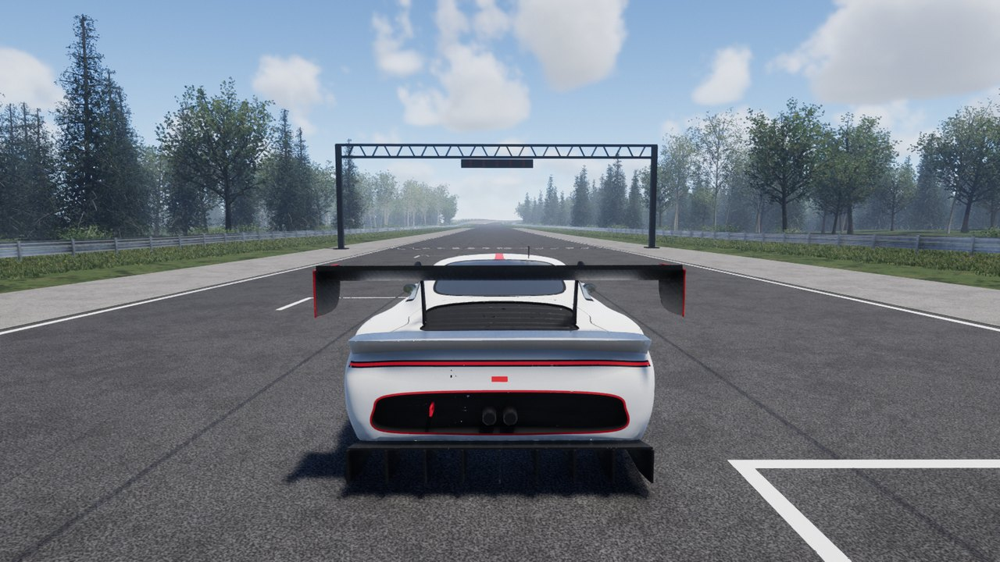
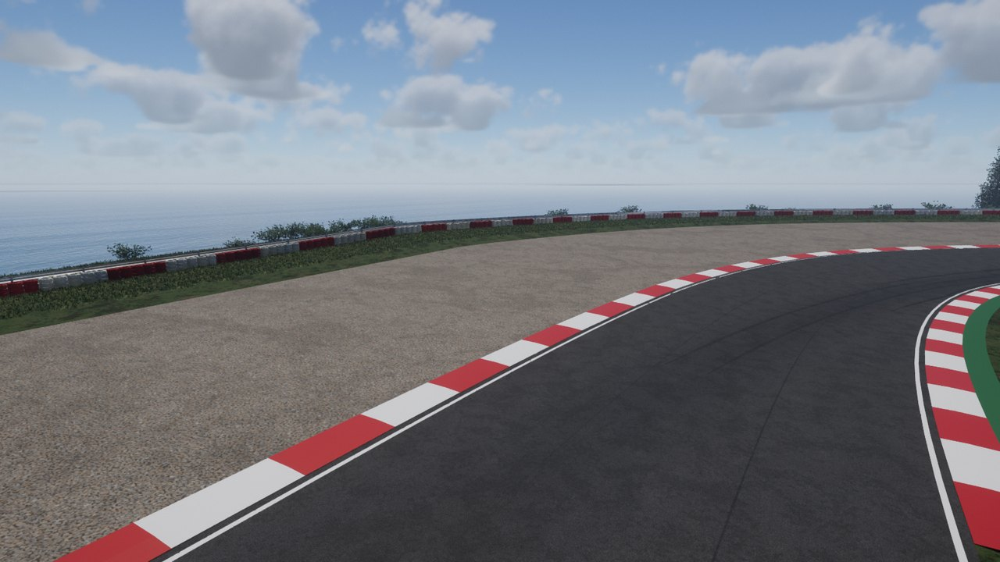
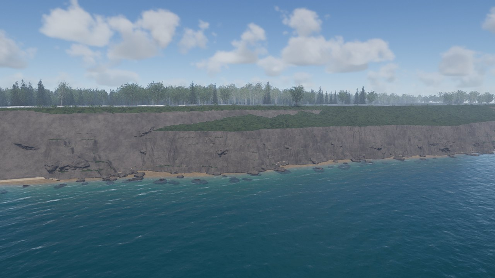
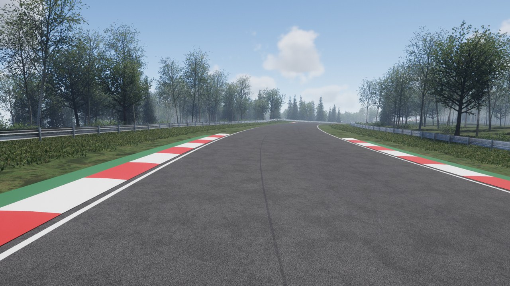

# Kestrel Head

[](https://github.com/SamG-Coder/solstice-racing/actions/workflows/ci.yml)
[](https://github.com/SamG-Coder/solstice-racing/actions/workflows/pages.yml)
[](LICENSE)

A racing game built on [Solstice](https://github.com/SamG-Coder/solstice), a Nanite and Lumen
style renderer in Rust and WebGPU: a GT3 car on a three-kilometre circuit round an island, along
its cliffs and through its woods.

**[Play it in the browser](https://samg-coder.github.io/solstice-racing/)**, in one with WebGPU
such as Chrome or Edge, with the keyboard or a gamepad.



| The hairpin at the point | Along the cliffs | Up through the woods |
|---|---|---|
|  |  |  |

- **The car** is modelled in Blender from a GT3 car's published dimensions
  (`tools/blender/gt3r`), and driven by a vehicle model of its own
  (`crates/solstice-vehicle`): Pacejka tyres with combined slip and load sensitivity, sprung and
  damped suspension with anti-roll bars, an engine, clutch, gearbox and differential solved
  together, aerodynamic drag and downforce, anti-lock brakes and traction control.
- **The circuit**, Kestrel Head, is drawn as a handful of points (`tools/track/make_coast.py`).
  From its track file the bake builds everything else (`apps/bake/src/circuit`): the island and
  its cliffs, the road with its racing line of rubber, kerbs, gravel, barriers and tyre walls,
  the grass and the woods.
- **Laps are timed**, with sectors, and a lap that leaves the road does not count.

## Driving

| | Keyboard | Gamepad |
|---|---|---|
| Throttle and brake | **W** / **S** or the arrows | Right and left triggers |
| Steer | **A** / **D** or the arrows | Left stick |
| Handbrake | **Space** | **B** / circle |
| Change gear (manual cars) | **E** up, **Q** down | Bumpers |
| Back on the track | **R** | **Y** / triangle |
| Camera: nearer, further, high above, on the car | **C** | Select (Create on a PS5 pad) |
| Look round the car, and over it | **J** / **L**, **I** / **K** | Right stick |
| Look behind | **B** | Right stick, pressed |
| Let the car drive itself | **P** | Start (Options) |

Gamepads work in the browser, through its standard layout, and natively, through `gilrs`.

The car has anti-lock brakes, traction control and stability control, which catches the tail
when it steps out, and its steering follows a slide as a real wheel pulls a driver's hands
round. They are what make it a car that can be driven hard with keys. A car's file turns each
off (`scenes/circuit/gt3r.vehicle`, `assists`).

## Running it

In the browser, the game is built and deployed by GitHub Actions (`.github/workflows/pages.yml`)
whenever `main` changes. The circuit itself is baked on a PC, as it needs the car's model, and
published as a release, which the workflow downloads and serves beside the page:

```bash
python scripts/publish-circuit.py --bake
```

Natively, make the car and the track, bake the circuit and drive it:

```bash
blender --background --factory-startup --python-exit-code 1 --python tools/blender/gt3r/make.py -- target/gt3r/gt3r.glb --engine target/circuit/gt3r.glb
```

```bash
python tools/track/make_coast.py
```

```bash
cargo run --release -p bake -- --scene scenes/coast.txt --output assets/coast.solstice
```

```bash
cargo run --release -p viewer -- assets/coast.solstice --play
```

To try the browser build on your own machine, run `bash scripts/build-web.sh`, then
`python scripts/serve.py`, and open <http://localhost:8765>.

The rest of this file is the engine's own.

---

# Solstice

[](https://github.com/SamG-Coder/solstice/actions/workflows/ci.yml)
[](LICENSE)

A real-time renderer in Rust and WebGPU, built on the same core ideas as Unreal Engine 5's
Nanite and Lumen: virtualized geometry and dynamic global illumination, running in the browser.

**[Try the live demo](https://samg-coder.github.io/solstice/)** in a WebGPU browser such as Chrome
or Edge. It has three scenes, a ruined temple, a fort on a cove built from photoscans, and a meadow
at the edge of a wood, streamed as you look around at a quality level that suits your GPU. Over
them, volumetric clouds drift with the wind while the weather changes by itself, and the day
passes: the sun crosses the sky, and night brings the moon in its true phase, the stars and the
Milky Way.


Solstice is an independent implementation written from published techniques. It contains no
Epic Games code and is not affiliated with Epic Games.

| Multi-bounce firelight | Daylight | Cluster view |
|---|---|---|
|  |  |  |

| A meadow and wood, all procedural | Fair-weather cumulus over the cove | Broken cloud over the temple |
|---|---|---|
|  |  |  |

| Sunrise over the cove | A gibbous moon at midnight | The Milky Way on a moonless night |
|---|---|---|
|  |  |  |

## Quick start

```bash
cargo run --release -p bake -- --quality web --output assets/web.solstice
```

```bash
bash scripts/build-web.sh
```

```bash
python scripts/serve.py
```

Then open <http://localhost:8765> in Chrome or Edge.

### Publishing the site's scenes

The site does not bake or deploy its scenes: they take minutes to bake and hundreds of megabytes
to move. Each scene has its own repository and Pages site, such as
[solstice-scene-forest](https://github.com/SamG-Coder/solstice-scene-forest), served on the same
domain as the viewer, so the browser can stream it, which it cannot from a GitHub release.
Publishing one scene never redeploys the viewer or the others.

Bake on a PC and publish: the script compares each scene with the checksum its site records,
and for each one that changed, uploads it as a release of that scene's repository and updates
its `scene.txt`, which deploys it. `--check` reports what would be published.

```bash
python scripts/publish-scenes.py --bake forest
```

For the native viewer, bake the full scene and run it:

```bash
cargo run --release -p bake
```

```bash
cargo run --release -p viewer
```

Both viewers use **click** to look, **WASD** to move, **Q/E** for down and up, and **Shift** to go
faster. The browser page also has controls for debug views, the weather, the time of day and render
scale. Its weather starts as **Changing**, which drifts from one kind of weather to the next on its
own; the menu fixes one instead, and **Extras** can follow a place's real weather (from
[Open-Meteo](https://open-meteo.com)). A day passes in 20 minutes: the **Time of day** slider follows
the clock and sets it, **Time passes** speeds it up, slows it to real time or stops it, and **North**
turns the sky around the scene. The page also takes `?time=HH:MM` and `?day-length=SECONDS`.

The native viewer takes `--weather NAME` or a weather file, and **C** moves to the next kind of
weather. `--time HH:MM` starts a clock, with `--day N` (day of the year), `--latitude DEGREES` and
`--day-length SECONDS`; **T** moves the clock on an hour.

## Your own models

Any glTF 2.0 file (`.gltf` or `.glb`) can be baked into a scene:

```bash
cargo run --release -p bake -- --gltf model.glb --fit 4 --ground --output assets/model.solstice
```

```bash
cargo run --release -p viewer -- assets/model.solstice
```


*[Boulder 01](https://polyhaven.com/a/boulder_01) by Rico Cilliers, from Poly Haven (CC0), imported
with the command above. The scan is not included in this repository.*

`--fit` scales the model so its longest side is that many metres, and stands it on the ground. The
GI system works in fixed world-space sizes, so use it for models in other units or at unusual
scales. The ground is at Y = 0 when that lies in the lower half of the model, as it does for most
scans, and otherwise at the model's lowest point. `--ground` adds a floor, and `--texture-size` sets the resolution all textures are resampled
to (default 1024, must be a power of two). Textures are block compressed unless you pass
`--raw-textures`. To see it in the browser, run `scripts/build-web.sh` and
open `http://localhost:8765/?scene=model`.

**Imported:** node hierarchies, instancing, mirrored transforms, multiple materials, double-sided materials, base colour,
normal, metallic-roughness and occlusion maps, material factors and emissive factors.

**Not yet, and the bake prints a warning when a file uses them:** transparency and alpha masks (drawn
opaque), emissive textures, texture transforms, a
second UV set, punctual lights, animation and skinning (imported in their rest pose). Files that
require compressed texture or geometry extensions, such as Basis or Draco, are rejected.

## Building scenes

A scene file places many models, or individual pieces of a modular kit, in one world:

```text
terrain 900 1024 0.3 52                       # size, cells, height, X where the shore begins
water -0.6 0.015 0.06 0.075                   # height, then colour
camera 66 1.5 -41 2.31 0.03                   # x y z yaw pitch
model rocks/rock.gltf 30 0 10 45 1.5          # path x y z yaw_degrees scale
model rocks/rock.gltf 9 ground:0.2 4 45 1.5    # on the terrain, lowest 20% buried
part fort/fort.gltf tower_round 22 0 22 0 1   # one named piece, by its own origin
```

[`scenes/cove.txt`](scenes/cove.txt) is a complete example: a fort assembled piece by piece from a
modular kit, overlooking a bay with a ship at anchor, using 12 Poly Haven scans (CC0). It holds
22 million instanced triangles, and renders in about 3.5 ms on an RTX 5080. To build it, adding
`--texture-size 1024` for the smaller version used in the browser:

```bash
python scripts/fetch-scans.py scenes/cove.txt 2k
```

```bash
cargo run --release -p bake -- --scene scenes/cove.txt --output assets/cove.solstice
```


## Trees, grass and weather as data

Trees, grass and weather are each described by a short text file, so a new tree or a change to
one needs no code. Every setting has a default, so a file names only what differs from it, and a
mistake is reported with its line number.

```text
# Abridged from crates/solstice-procgen/species/fir.species
height 16
trunk radius=0.22 flare=0.45 gnarl=0.015
crown cone
bark fir_bark
level per_metre=8 span=0.1..0.99 angle=102..74 length=0.2 radius=0.4 droop=0.3 whorl=5
level per_metre=10 span=0.05..0.97 angle=62 length=0.4 radius=0.55 droop=0.12
leaves fir_needles per_metre=22 length=0.16..0.26 width=0.17
```

```text
# Abridged from crates/solstice-procgen/grass/verge.grass
size 2
tufts per_m2=40 blades=6..16 height=0.12..0.35 width=0.004..0.008 lean=0.15..0.85
weed kind=rosette per_m2=6 leaves=6..12 length=0.08..0.2 flowers=0.6 flower=0.6,0.42,0.01
weed kind=clover per_m2=20 length=0.01..0.018 stalk=0.04..0.1 flowers=0.4 flower=0.55,0.42,0.45
```

```text
# Abridged from crates/solstice-render/weather/broken.weather
coverage 0.62
type 0.95          # 0 is flat stratus, 1 heaped cumulus
base 1000          # metres
thickness 2600
wind speed=10 from=240
```

The built-in files are oak, birch, fir and bush; meadow, lawn, dry, tall and verge grass; and clear,
fair, broken, overcast, storm and cirrus weather. To see every tree and breed of grass side by
side, with any files of your own:

```bash
cargo run --release -p bake -- --plants --species my.species --grass my.grass --output assets/plants.solstice
```


## Using the library

```rust
let scene = SceneAsset { meshes, materials, instances, lights, texture_size, textures };
let mut renderer = Renderer::new(&gpu, &scene, surface_format, RendererSettings::default());

// Every frame:
renderer.render(&gpu, &camera, &environment, &output_view, output_size, delta_seconds);

// Weather, at any time: one kind, eased into over 30 seconds, or a sky that changes by itself.
renderer.set_weather(Weather::by_name("broken").unwrap(), 30.0);
renderer.set_weather_changing(true, "fair");

// The time of day: where the sun, moon and stars are, and how they light the scene. `daylight`
// is the scene's lighting under a high sun; the time keeps its colour and strength.
let mut time = TimeOfDay { day: 172.0, hours: 20.5 };
let environment = time.environment(&Place::default(), &daylight);
time.advance(delta_seconds / 3600.0);
```

Meshes come from `solstice_builder::build_virtual_mesh`, which runs offline. See
[`apps/bake`](apps/bake/src/scene.rs) for a complete example scene.

## How it works

```
crates/solstice-builder   Mesh -> cluster LOD DAG (offline)
crates/solstice-import    glTF 2.0 -> scene (offline)
crates/solstice-procgen   Procedural surfaces, trees, grass and weeds (offline)
crates/solstice-asset     GPU data layouts and the scene file format
crates/solstice-render    The renderer
apps/bake                 Bakes scene files: procedural demo content or imported models
apps/viewer               Native and browser front ends
```

[`Renderer::render`](crates/solstice-render/src/renderer.rs) reads top to bottom as the recipe for
a frame. There is deliberately no render graph: every pass is a plain struct with `record`.

### Virtualized geometry

**Offline**, each mesh becomes a DAG of 128-triangle clusters: cluster, group neighbours,
simplify each group with its boundary locked, split into new clusters, repeat. Grouping changes
every level, so seams locked at one level are simplified away at the next.

**Each frame**, compute shaders walk a per-mesh hierarchy and pick a *cut* through the DAG, so that
projected error stays under one pixel. Two-phase occlusion culling tests last frame's depth, draws,
rebuilds the depth pyramid, then retests what it rejected. Small clusters go to a software
rasterizer in a compute shader, and the rest to the hardware rasterizer. Both write one visibility
buffer, which a final pass resolves to a G-buffer with analytic derivatives.

### Lighting

- **Sky:** physically based atmosphere (Hillaire 2020), with multiple scattering.
- **Sun:** four cascaded shadow maps drawn through the same culling, plus screen-space contact
  shadows. A cascade is only redrawn when its view changes, which removes the largest single cost
  on small GPUs.
- **Global illumination:** nearby geometry is voxelized into five clipmap levels, with a distance
  field for fast ray marching and cached radiance on each surface voxel. Those voxels gather
  light from each other over time, which gives unlimited bounces. Sparse screen probes trace into
  this volume, first through the depth buffer for contact detail, and each pixel interpolates them.
- **Screen traces:** probe rays and reflections first march a pyramid of the nearest depth of each
  screen tile, as Lumen's screen traces do, skipping whole tiles a ray passes in front of. Hits
  take their colour from last frame's image, found through motion vectors.
- **Reflections:** one glossy ray per half-resolution pixel: screen space, then the volume, then sky.
- **Clouds:** volumetric, ray marched through noise in a layer over a curved planet. They cast
  shadows on the ground, and a small panorama of them feeds the skylight, GI and reflections, so
  an overcast sky dims and greys the whole scene. See below.
- **Post:** temporal anti-aliasing and upscaling, histogram exposure, bloom, ACES tone mapping, and
  contrast-adaptive sharpening on the displayed values, held within each pixel's neighbours so that
  no edge gets a dark halo.

### Clouds and weather

The clouds follow the method of Horizon Zero Dawn and Unreal's volumetric clouds. Tiling 3D noise,
Perlin-Worley for shapes and Worley for detail, is generated on the GPU once. A weather map says
where cloud can form; its values are ranked when it is made, so that a coverage of 0.6 really
covers 60% of the sky. Each kind of cloud has a height profile, from a thin sheet of stratus to
heaped cumulus and storm anvils, and detail noise erodes the edges into wisps below and billows
above.

Light comes from a short march towards the sun, a two-lobed phase function, multiple scattering
in octaves, and a diffusion term for light that has crossed hundreds of metres of cloud, which is
why thick cloud bases are grey rather than black. Skylight is shaded by the cloud above, sunlit
ground lights the bases from below, and distant clouds fade into the haze.

Each frame the weather eases towards its target, the wind carries everything along, and shapes
slowly boil upwards. The clouds on screen are marched at half resolution and blended with last
frame's, reprojected; texels behind geometry are skipped. At 1080p in the forest they cost about
0.3 ms of GPU time.


### Time of day, the moon and the stars

The sun follows the standard formulas for its declination through the year and its hour angle
through the day, at the scene's latitude. The moon is a simpler model, good for the look rather than
an almanac: it goes through its phases every 29.53 days, is opposite the sun when full, and so rises
about 50 minutes later each day. The stars sit on a celestial sphere placed from the sidereal time,
so that the constellations and the Milky Way stand where they would that night: from 38 degrees
north at midnight in late June, the galactic centre is 23 degrees up in the south, as a test checks.

- **Twilight.** As the sun sets, the sky tables keep the air glowing. The night sky's own faint
  glow, of airglow and starlight, is always there, lost by day, so twilight fades down to it and can
  never dip below night. Below 10 degrees the moon takes over the lighting, in near darkness where
  the change cannot be seen. Exposure stays tied to daylight, so night is dark rather than grey.
- **Stars.** Three layers, from about 150 bright stars to many thousands of faint ones, with each
  fainter magnitude about three times as common, as in the real sky. Each is coloured by its
  temperature through Planck's law, dimmed and reddened by the air near the horizon, and twinkles
  more the lower it is. They are drawn as spots about a pixel across at any resolution, found from
  the eight nearest cells of a thin shell, which keeps the whole night sky to about 0.2 ms.
- **The Milky Way.** Placed by the real galactic coordinates, brightest towards Sagittarius, with
  star clouds and dust lanes along the Great Rift. It never changes on the celestial sphere, so it is
  worked out once into a map, and costs one texture read a pixel.
- **The moon.** It shows the near side's real seas, sized from their true diameters, with Tycho's
  rays at full moon, and keeps its north towards the celestial pole. It reflects light as dusty
  regolith does (Lommel-Seeliger), so the full moon is as bright at its edge as at its centre, and
  earthshine lights its dark side when it is a crescent. By day it is as bright as it truly is and
  shows pale against the blue; by night it is dimmed, as the eye adapts to it, so its face shows.
- **The horizon.** Over a long path the air takes the colour of the sky at the horizon, so distant
  land and sea fade into exactly that colour, and anything seen or reflected beyond the scene below
  the horizon takes it too: sea and sky meet without a seam.

### Trees and grass

Every leaf, needle and blade is geometry of its own, never a picture on a transparent card. As
Nanite foliage does, the cluster builder thins small separate pieces with distance and enlarges
the ones it keeps, so that a meadow covers as much from far away as close up. Trees are grown from
their species: levels of branches spiral round their parents at the golden angle, or grow in
whorls on conifers; the crown's outline sets how long the trunk's branches are at each height.
Barks are surfaces of the procedural library, with a texel per millimetre; oak bark is matched to
a photoscan by colour statistics and the steepness of its normals.

### Where WebGPU forced a different design from Unreal

| Unreal 5 uses | WebGPU lacks it, so Solstice uses |
|---|---|
| Mesh shaders | Compute culling and instanced vertex pulling |
| 64-bit atomic visibility buffer | Separate 32-bit depth and ID buffers. Two triangles racing on a pixel can leave a one-frame wrong ID, which temporal AA hides |
| Bindless resources | Shared geometry buffers and texture arrays |
| Hardware ray tracing | Software tracing against the voxel and distance-field volume |
| Work queues that grow themselves | One dispatch per hierarchy level, over a shared queue |

## Measurements

The full scene has 26,945 instances and 8.76 billion instanced triangles, 4.5 million of them unique,
in a 179 MB scene file baked in about 30 seconds on a desktop CPU. Native, Vulkan, RTX 5080, 1600x900,
at High quality:

| View | Frame time | Triangles drawn |
|---|---|---|
| Exterior | 5.9 ms | 7.0 M |
| Exterior, camera moving | 6.2 ms | 6.9 M |
| Inside the chamber | 5.9 ms | 9.9 M |

The web scene has 1.22 billion instanced triangles and is a 52 MB file. Native on the AMD
integrated GPU of the same machine, with the camera moving, since a still camera hides shadow costs:

| Resolution, quality | Frame time, moving | Worst frame |
|---|---|---|
| 1600x900, High | 117 ms | 196 ms |
| 1600x900, Low | 49 ms | 84 ms |
| 1280x720, Medium | 57 ms | 106 ms |
| 1280x720, Low | 39 ms (about 26 fps) | 74 ms |

The slowest frames are when a shadow cascade has to redraw. So integrated graphics runs at
Low with visible stutter, and is usable rather than smooth.

A scripted 60 second flight around the cove, saving an image each second and reporting every frame's
timing (`viewer assets/cove.solstice --flyover scenes/cove_flyover.txt --out DIR`):

| GPU, resolution, quality | Average | 95th percentile | Worst frame | Frames over 33 ms |
|---|---|---|---|---|
| RTX 5080, 1600x900, High | 3.8 ms | 5.7 ms | 8.5 ms | 0 of 3570 |
| AMD integrated, 1280x720, Low | 30 ms | 37 ms | 43 ms | 753 of 3570 |

Browsers tested on Windows, with the RTX 5080: Chromium 152, Edge 156 and Firefox 159, with no GPU
errors in any, and frame rates at each display's limit where it could be measured. **Not tested:**
Safari, phones, Mac and Linux GPUs, and any browser running on integrated graphics. The GI volume
takes about 150 MB of GPU memory regardless of quality level, which may rule out the smallest GPUs.

### Streaming

Scenes load on demand. A file holds a small manifest, then geometry in 128 KiB pages and textures
by mip level, so the browser reads what the view needs with HTTP Range requests. For the browser
cove at 50 Mbit/s, on an RTX 5080, with [the details here](docs/streaming.md):

| | Before | After |
|---|---|---|
| Download before the first image | 209 MB | **6.0 MB** |
| First image | 36.5 s | **1.4 s** |
| The opening view at full detail | At the first image | About 17 s, 61 MB in all |
| Scene data on the GPU | 280 MiB | **195 MiB, fixed** |
| Whole viewer on the GPU, browser | 855 MiB | **668 MiB** |

**No holes.** Culling records which pages each view wants, and the CPU loads them. A cluster keeps
drawing until the set simplified into it has arrived. Parents always install before children and
leave after them, so a partly loaded scene is still a valid cut through the DAG.

**Fixed memory.** Geometry goes in a pool of page slots, evicting the least recently used page that
nothing depends on. Textures go in three tiers of arrays, since WebGPU has no sparse textures:
every layer at 128 and 512, and a few slots at the largest size that fits. Add `?geometry-mb=64` or
`?texture-mb=32` to the page to try other budgets.

**Natively**, the viewer still loads everything, which keeps frame times comparable. Add `--stream`
to read from disk as needed, with `--geometry-budget-mb` and `--texture-budget-mb`.

A static host needs no setup. Without Range support, the page downloads the file once and streams
from memory. `scripts/serve.py` adds Range and a bandwidth limit for local testing, with
`--throttle-mbps`.

### Texture compression

Scene files hold GPU block-compressed textures, at 3 bytes per texel where they used to take 8.
For the cove, with 23 texture layers, measured on the RTX 5080 before streaming, when files were
gzipped and loaded whole. GPU memory is the whole viewer's and most of it is not textures, which is
why it falls by less than the file does:

| Scene | File | Gzipped download | Textures on the GPU | GPU memory, native | GPU memory, browser |
|---|---|---|---|---|---|
| Cove at 2048, uncompressed | 1,227 MB | 697 MB | 1,029 MB | 2,532 MiB | |
| **Cove at 2048, BC** | **584 MB** | **451 MB** | **386 MB** | **1,809 MiB** | |
| Browser cove at 512, uncompressed | 263 MB | 163 MB | 64 MB | 1,551 MiB | 1,134 MiB |
| **Browser cove at 1024, BC** | **295 MB** | **209 MB** | **96 MB** | **1,553 MiB** | **1,133 MiB** |

So the browser cove gets four times the texels for the same GPU memory and a 28% larger download.
At 2048, renders differ from the uncompressed version by 43 to 48 dB, and side by side at 3x
zoom the fort walls show no blocks or lost relief:


**Formats.** The old surface layer packed normal XY, roughness and metallic together, and no single
format holds that well, so it is now two maps. On the scanned fort wall, at 2048:

| Normals stored as | Mean error | 99th percentile | Roughness |
|---|---|---|---|
| BC7, packed with roughness and metallic | 1.81 degrees | 6.4 degrees | 38.8 dB |
| BC5, on their own (roughness and metallic in a second BC5) | 1.11 degrees | 4.3 degrees | 52.2 dB |

Colour and cavity are BC7 with the sRGB format, which measured about 42 dB on the same wall against
36 dB for BC1 at half the size.

**Encoders.** BC7 comes from [`block_compression`](https://crates.io/crates/block_compression), a pure
Rust port of Intel's ISPC compressor, at its "basic" setting: "slow" took three times as long and
gained under 0.05 dB. BC5 comes from an endpoint search in
[`texture.rs`](crates/solstice-builder/src/texture.rs), as that crate's BC5 scored 1 dB lower on normals.
Compressing the cove takes about a minute on 16 threads.

**Other GPUs.** WebGPU exposes `texture-compression-bc` on desktop GPUs, while phones generally expose
`texture-compression-etc2` and `texture-compression-astc` instead. The crates that encode ASTC or ETC2
well wrap C++, not Rust, so files hold BC only, and a GPU without it gets the textures unpacked while
loading, at no more than 512 per side. That matches the old uncompressed browser scene in look and GPU
memory. Add `?unpack-textures` to the page, or `--unpack-textures` to the viewer, to force that path. It
has only been tested that way, on the RTX 5080: no phone has been tried. See
[testing without BC](docs/testing-without-bc.md) for what to check on one.

## Status: what this is and is not

The goal is Unreal-quality rendering in the browser. The core architecture is real and working.
The image is not yet at Unreal's level, and these are the main reasons, roughly in order of impact:

1. **Demo content.** Unreal's best images come from photoscanned assets. The live demo's cove uses
   scanned models, on procedural sand, while its temple is entirely procedural and looks it. Its
   forest is procedural too: a meadow and wood of geometric grass, trees and bushes.
2. **Shadow resolution.** Cascaded shadow maps stand in for Virtual Shadow Maps, so shadows lack
   the per-pixel sharpness that makes dense geometry read properly.
3. **Streaming's limits.** Cluster records stay resident at 48 bytes each, about 0.7 GB for a
   billion unique triangles, where Nanite pages those too. Detail appears with no cross-fade.
4. **Static scenes only.** Moving objects are not supported: no animation, and the GI volume is
   only rebuilt when the camera moves. Previous-frame transforms exist in the data but are not fed.
5. **Surface features.** One material per instance (multi-material models become several instances),
   no translucency, no subsurface scattering, no volumetric fog, no material graph.
6. **GI limits.** Voxels mean thin walls can leak light, and the finest voxels are 20 cm, so small
   details get their indirect shadowing only from screen-space passes.
7. **Texture memory.** All textures are resampled to one size, so models with many materials use a
   lot of memory even when compressed, and phones must unpack them, as nothing bakes ASTC yet.
8. **Far reflections.** Beyond the reach of screen-space tracing, reflections come from voxels, which
   turn thin objects such as a ship's rigging into solid dark masses on water.
9. **Alpha.** Masked and transparent surfaces draw solid, so torn sails have no holes.
10. **Weather's limits.** No rain or snow falls, there is no lightning, and clouds are drawn only
    where the sky shows, so low cloud never passes in front of a mountain. Under heavy cloud a thin
    bright fringe can show along ridges against the sky.

## Tests

```bash
cargo test --release
```

- The key property of the DAG: every LOD cut is **watertight**, at uniform thresholds and from
  perspective viewpoints that mix levels.
- All WGSL is validated without a GPU. Procedural meshes are checked to be closed and outward-facing.
- The importer is tested against small hand-written glTF files, so that every expected value is
  known exactly, including the classic bugs: inverted normal maps and inside-out mirrored instances.
- GPU tests render real frames and check for validation errors, that no pixel is missing inside a
  closed surface, and that occlusion culling skips hidden geometry. Others check the clouds: that a
  clear sky is blue and an overcast one grey, that overcast all but removes shadows, and that the
  wind moves the clouds. Others check the time of day: that twilight only ever grows darker on its
  way into night, that the moon has no dark halo, and that a moonless night is full of stars. They
  skip themselves if no GPU is available.
- The sky's positions are checked against the real sky: sunrise in the east, the sun due south at
  noon, the moon's phases, the sun at its own place among the stars, and the galactic centre.
- Shaders are also checked for operator mixes that browsers reject but native compilers accept.
- Every built-in tree, breed of grass and kind of weather is read and written back unchanged, and
  each procedural surface is checked for seams, plausible brightness and steepness.

To check only what a change affects, as CI does for pull requests, run the checks for the
crates whose files changed and everything that depends on them. That covers formatting, clippy,
the tests (the GPU tests too) and, when the viewer is affected, the browser builds. Uncommitted
work counts:

```bash
scripts/check-changed.sh
```

`scripts/affected.py` makes the choice: changing the renderer checks the renderer and the
viewer, not the gameplay crates. A change outside every crate, such as `Cargo.lock`, CI, a build
script or a scene, checks everything, and documentation checks nothing. Every push to `main`
checks the whole workspace, whatever the change.

## Contributing

Solstice is written and reviewed entirely by frontier AI models: all code, documentation, pull
requests, reviews, issues and comments. People direct the work and decide what is merged, but write and review none
of it. See the [Code of Conduct](CODE_OF_CONDUCT.md).

## License

[MIT](LICENSE)
